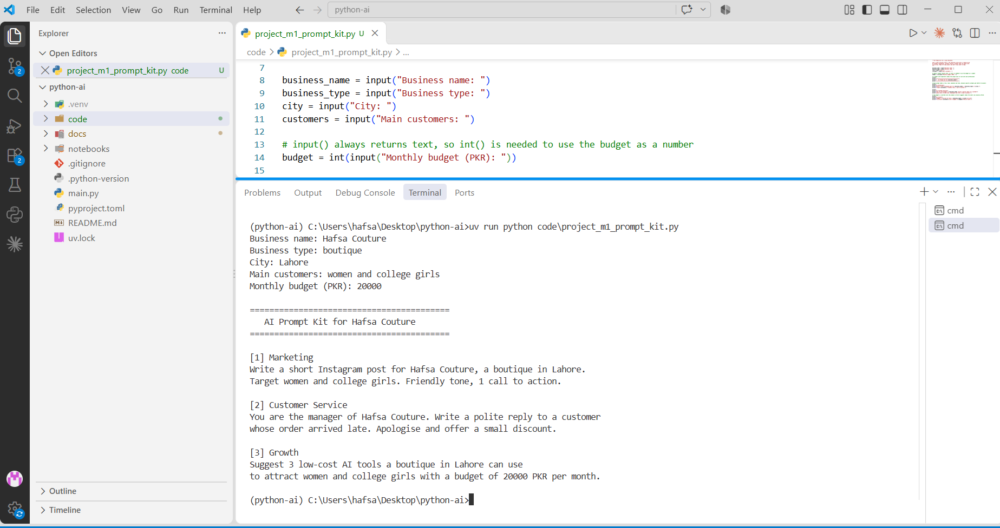
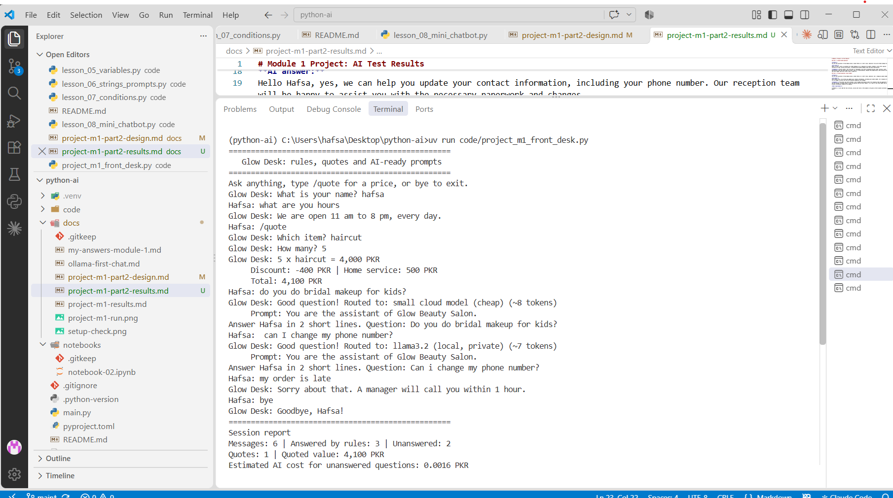
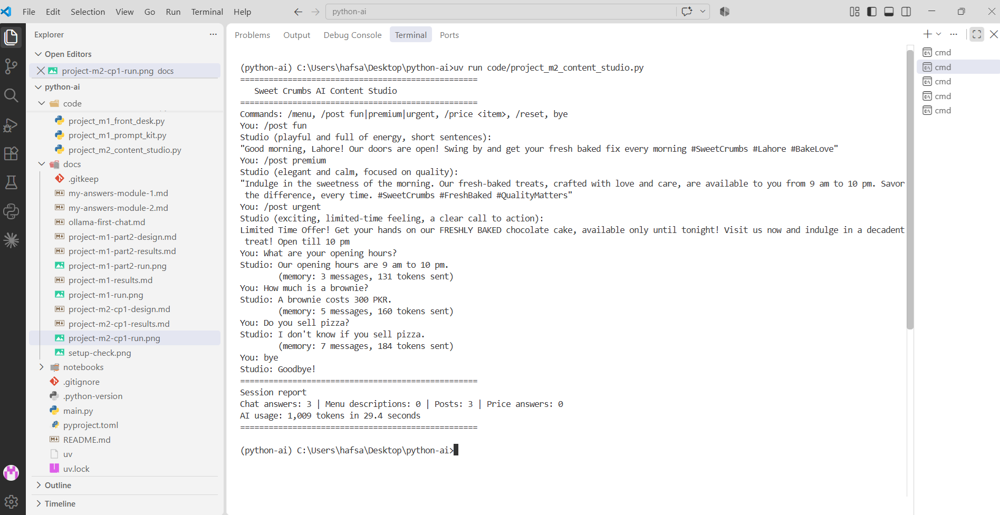

# Python for AI: Module 1

**Name:** Hafsa
**Course:** Python for AI

**My AI goal:** I want to become an AI Agent Developer and build AI tools that help local businesses save time.

## How to run

    uv run main.py

## Lessons done

- Lesson 1.1: AI career intro
- Lesson 1.2: Toolkit proof
- Lesson 1.3: Client-ready repo
- Lesson 1.4: Business prompt builder


## Module 1 Project: AI Prompt Kit

A Python tool that turns a local business's details into 3 ready-to-use AI prompts.

**Run:** `uv run code/project_m1_prompt_kit.py`



**Who would pay for this:** Small boutique and shop owners who want AI help but don't know what to type.--
## Task 1.8: Business Helper Bot Design

Business: Glow Beauty Salon

| Intent | Keywords | Reply |
|---|---|---|
| Complaint | late, bad, problem, angry | Sorry about that. The manager will call you today. |
| Timings | timing, open, close | We are open 11 am to 8 pm, every day. |
| Prices | price, fee, cost, how much | Haircut is 800 PKR and facial is 2,000 PKR. |
| Location | where, location, address | We are in Gulberg, Lahore. |
| Appointment | appointment, book, booking | Call 0300-1234567 to book your appointment. |
## Module 1 Project: Glow Beauty Salon Front Desk

A front desk assistant for a beauty salon that answers common questions with rules, gives exact price quotes, and turns unanswered questions into AI-ready prompts.


**Run command:**

```
uv run code/project_m1_front_desk.py
```

**Screenshot:**




**Value for the owner:** Staff ko baar baar timings aur prices nahi batani paren gi, price quotes mein galti nahi hogi, aur AI ka paisa sirf zaroorat par kharch hoga.

## Module 2 Checkpoint 1: AI Content Studio

A content studio for Sweet Crumbs bakery that writes menu descriptions, streams social posts in 3 tones, answers prices from real data, and chats with customers using only real facts.

**Run:** `uv run code/project_m2_content_studio.py`



**Value:** The owner no longer spends hours writing item descriptions and weekly posts by hand, because the studio does it in minutes. Customers get instant, correct answers about prices and hours from real data, so the owner stops answering the same questions every day and would happily pay for it.