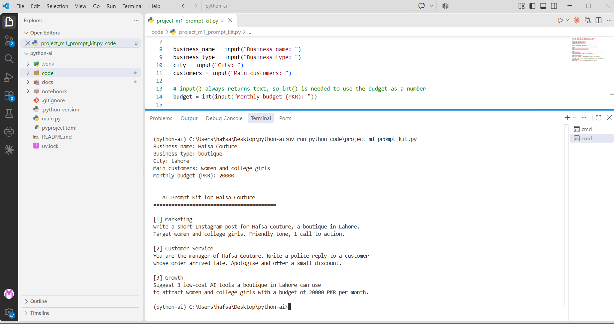

# Python for AI: Module 1

**Name:** Hafsa
**Course:** Python for AI

**My AI goal:** I want to become an AI Agent Developer and build AI tools that help local businesses save time.

## How to run

    uv run main.py

## Lessons done

- Lesson 1.1: AI career intro
- Lesson 1.2: Toolkit proof
- Lesson 1.3: Client-ready repo
- Lesson 1.4: Business prompt builder

## Module 1 Project: AI Prompt Kit

A Python tool that turns a local business's details into 3 ready-to-use AI prompts.

**Run:** `uv run code/project_m1_prompt_kit.py`

**Who would pay for this:** Small boutique and shop owners who want AI help but don't know what to type.